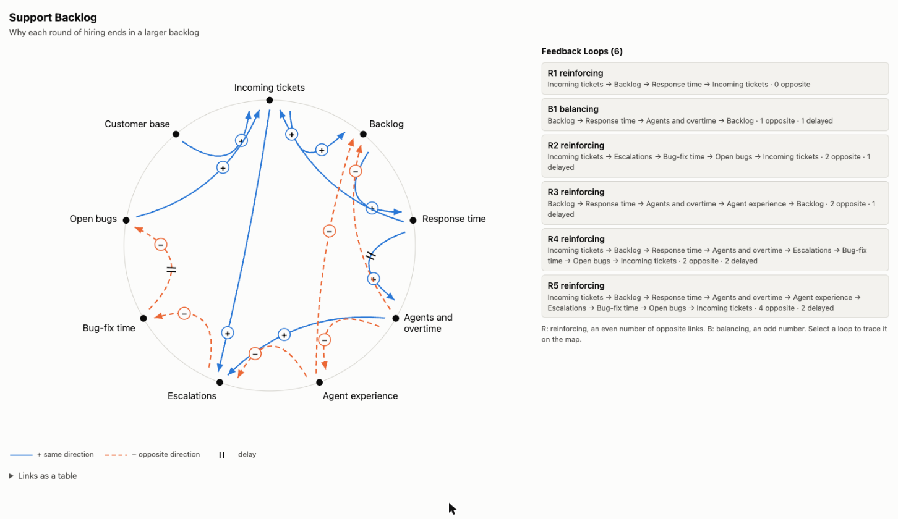
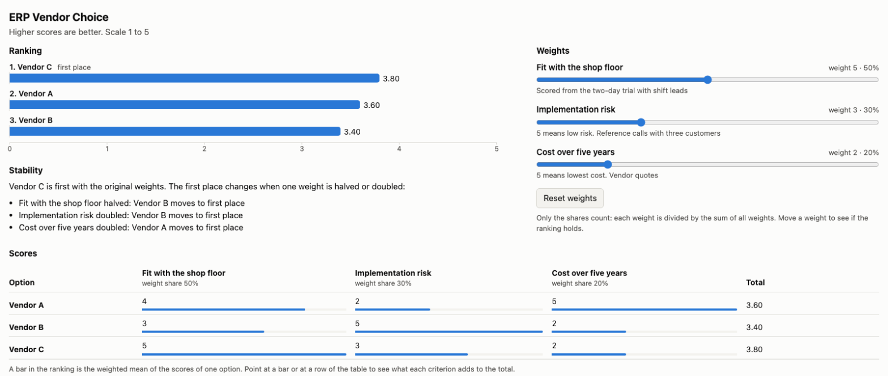
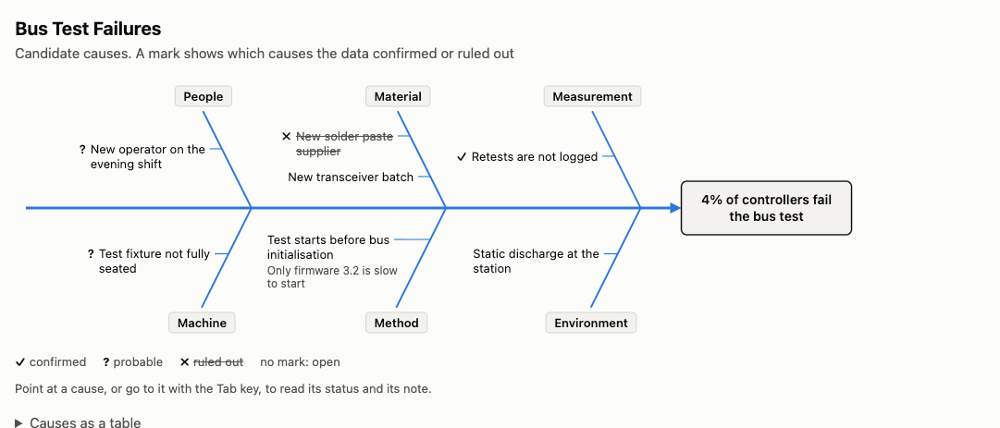
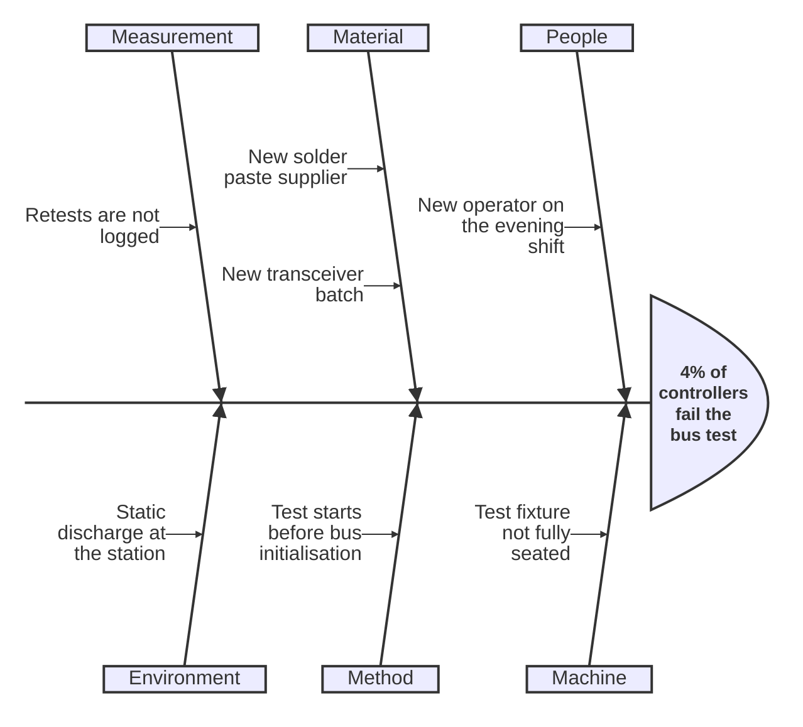

# Thinking Tools Skill

An agent skill that routes to 43 named thinking tools for problem
framing, diagnosis, systems analysis, decisions, plan tests, forecasts,
conflicts, strategy, and communication. The list starts from the 25
tools on [untools.co](https://untools.co) and adds tools for situations
that the untools list does not cover, such as the pre-mortem, Analysis
of Competing Hypotheses, reference class forecasting, and the kernel of
strategy.

For the tools whose artifact is a picture, the skill draws the picture:
a Mermaid block when the answer is Markdown (for example a note in
Obsidian), and a D3 page when the answer is HTML.

Written by Claude Code, for Claude Code and other agents that read
`SKILL.md` files.

## Diagrams

A loop map of a support backlog: the script finds the feedback loops
and gives each one its type, and the reader traces a loop on the circle.

| | |
|---|---|
|  |  |
| Decision matrix: move the weights and see if the ranking holds | Fishbone: each cause has a status |

- [Gallery](docs/gallery.md): each tool that has a diagram, with its
  Mermaid form and a picture of its D3 page
- [Live samples](https://cybernagl.github.io/skill-thinking-tools/):
  the seven D3 pages, to open and use

The same diagram in a Markdown note is a Mermaid block:

## Design

The skill is small on purpose. Agents were tested without it before a
line was written, and with it afterwards:

- A frontier model (Claude Fable 5.2) applied every named tool
  correctly in 11 of 11 runs without the skill, and reasoned soundly in
  10 runs where no tool was named. For such a model the skill adds the
  selection table and the traps. It does not add knowledge
- A small model (Claude Haiku 5.5) gave the correct structure for 32 of
  38 tools from memory. It failed on six less-known tools. Those six
  have a reference file in `tools/`. With the files, the small model
  applied all six correctly
- All other tools have one router row with their structure and their
  main trap
- A framework that the user did not ask for makes an answer worse. In
  a blind comparison of four ordinary requests, the answers written
  with an early version of the skill in context were longer and were
  judged worse in all four. The skill therefore has a narrow trigger
  and starts with a check that sends such requests back to a plain
  answer. After that change, a second blind comparison of three of
  the requests found no forced framework. The answers with the skill
  were judged slightly better in two cases and slightly worse in one,
  and they stayed somewhat longer than the plain answers. Each result
  is from single runs

The result is one skill with a router, not one skill for each tool. A
tool gets its own file only where a test showed that an agent gets it
wrong without one.

The diagrams follow the same rule:

- Asked for 16 diagrams without the skill, the small model drew the
  fishbone, the Wardley map, and Cynefin as plain flowcharts, which
  lose the shape of those diagrams. The frontier model used the
  fitting Mermaid type for two of the three, in a run of 25 minutes.
  The skill therefore has a snippet for those three types only, and
  rules for the rest
- With the skill, the small model wrote a valid fishbone and a valid
  Wardley map, and built a loop map page with the script. The loops in
  its answer were the loops that the script found. Each result is from
  one run
- The numbers on the pages are not left to the model. The script finds
  the loops, the ranking, and the expected values, and its results are
  checked against cases that were worked by hand
- A diagram is drawn only for a tool that the user asked for. In two
  test runs with ordinary requests and the skill in context, the
  answers had no diagram and no framework

## Install

    git clone https://github.com/cybernagl/skill-thinking-tools ~/dev/skill-thinking-tools
    ln -s ~/dev/skill-thinking-tools ~/.claude/skills/thinking-tools

The skill text has no dependencies. The script that builds the D3 pages
needs Python 3. D3 7.9.2 is in the repository (`viz/vendor`, ISC
licence), so the pages work offline. The three beta diagram types of
Mermaid need Mermaid 11.16 or later. GitHub renders them. Obsidian 1.15
and later states that it is compatible with Mermaid 12; that renderer
was not tested here.

## Contents

- `SKILL.md`: when to use the skill, how to choose a tool, the shape of
  an answer, and the router (12 situations, 43 tools)
- `tools/abstraction-laddering.md`
- `tools/confidence-speed-quality.md`
- `tools/conflict-resolution-diagram.md`: the Evaporating Cloud
- `tools/connection-circles.md`
- `tools/hard-choice-model.md`
- `tools/productive-thinking-model.md`
- `visuals.md`: which tools get a diagram, in which form, and the rules
  for Mermaid and for the D3 pages
- `mermaid/`: three snippets for the Mermaid types that agents get
  wrong: fishbone, Wardley map, Cynefin
- `viz/show.py`: builds one HTML page from a JSON file. Kinds: `loops`,
  `matrix`, `tree`, `hierarchy`, `fishbone`, `map`. With `--check` it
  prints the computed result and writes no page
- `viz/templates/`, `viz/lib/`, `viz/examples/`: the pages, the
  calculation code, and one example for each kind
- `docs/`: the gallery and the live samples

## Checks

    python3 viz/tests/test_show.py

The script checks the calculations against hand-worked cases, builds
each page, and runs the same checks on the JavaScript of the pages if
Node is installed. `python3 viz/build_samples.py` builds the sample
pages in `docs/samples` again after a change to a template.

    python3 viz/show.py mermaid mermaid/*.mmd --out /tmp/snippets.html --open

This builds a page that draws the snippets with a fixed Mermaid
version and shows each syntax error. It is a check for the snippets,
not a way to deliver a diagram.

The Zwicky box has its own skill:
[skill-zwicky-box](https://github.com/cybernagl/skill-zwicky-box).

## Sources and Credit

The selection of the first 25 tools follows untools.co. No text from
untools.co is copied. Each description is original, names the person
who developed the tool, and, for the six reference files, lists the
primary sources.

Other agent skills cover similar ground with a different design, for
example [cc-thinking-skills](https://github.com/tjboudreaux/cc-thinking-skills)
(one skill for each mental model) and
[suho/thinking-tools](https://github.com/suho/thinking-tools).

## License

MIT
