# Tools and Their Diagrams

Some thinking tools have an artifact that is a picture. For those tools the skill draws the picture in one of two forms:

- Mermaid, as a block in a Markdown document or note (for example in Obsidian)
- D3, as one self-contained HTML page that works offline

The samples on this page use made-up cases. Each D3 sample is a picture here; the link below it opens the live page. The full list of the 43 tools, with their structure and their main trap, is in [SKILL.md](../SKILL.md). The rules for the agent are in [visuals.md](../visuals.md).

| Tool | Markdown | HTML page |
|---|---|---|
| Causal loop diagram, connection circles, system archetypes | Flowchart with a sign on each link | [Loop map](#loop-map) |
| Ishikawa diagram | Fishbone | [Fishbone](#fishbone) |
| Wardley map | Wardley map | [Map](#wardley-map) |
| Impact-effort matrix | Quadrant chart | [Map](#impact-and-effort) |
| Issue tree, Minto pyramid, 5 Whys, second-order thinking, abstraction laddering | Flowchart | [Statement tree](#statement-tree) |
| Expected value and decision tree | Flowchart | [Decision tree](#decision-tree) |
| Decision matrix, Pugh matrix | Table | [Decision matrix](#decision-matrix) |
| Cynefin | Cynefin diagram | None |
| Conflict resolution diagram, ladder of inference, iceberg model, concept map, OODA loop | Flowchart | None |
| All other tools | None: the artifact is a list or a table | None |

## Loop Map

For a causal loop diagram or a connection circle. The script finds each feedback loop and gives its type: reinforcing (R) for an even number of opposite links, balancing (B) for an odd number. The reader selects a loop and sees it traced on the circle.

[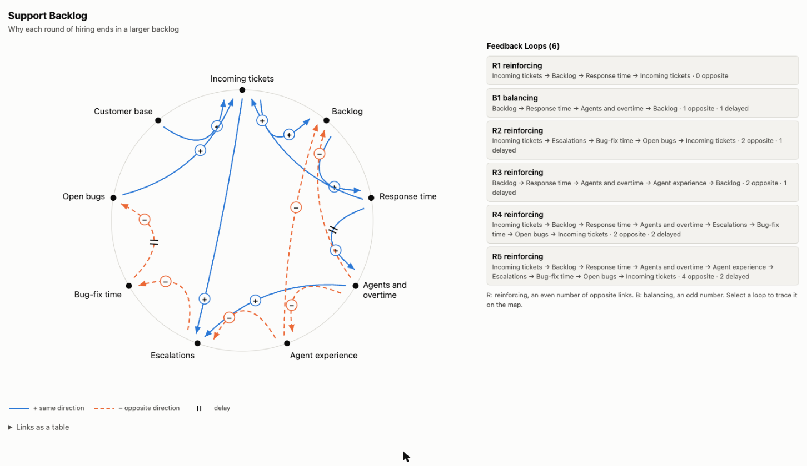](https://cybernagl.github.io/skill-thinking-tools/samples/loop-map.html)

[Open the live page](https://cybernagl.github.io/skill-thinking-tools/samples/loop-map.html) · [data](../viz/examples/loops-support-backlog.json) · `python3 viz/show.py loops data.json`

In Markdown:

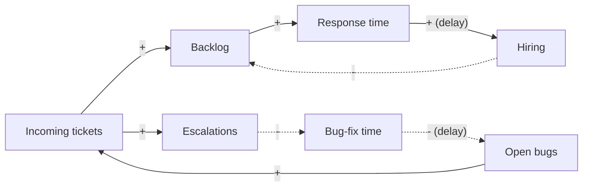

B1 balancing: Backlog, Response time, Hiring. R1 reinforcing: Incoming tickets, Escalations, Bug-fix time, Open bugs.

## Fishbone

For an Ishikawa diagram. Each cause has a status, so that the diagram shows which causes the data confirmed or ruled out, not only which causes were named.

[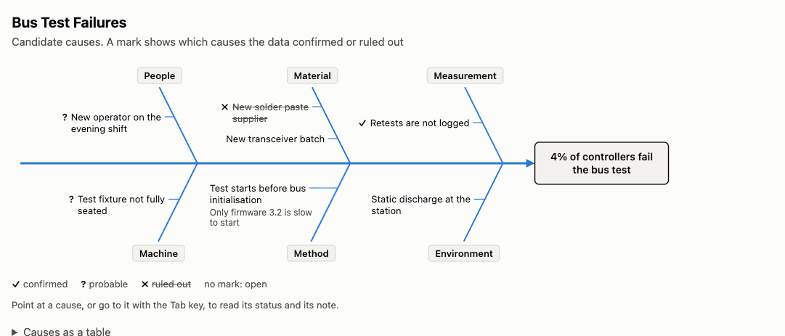](https://cybernagl.github.io/skill-thinking-tools/samples/fishbone.html)

[Open the live page](https://cybernagl.github.io/skill-thinking-tools/samples/fishbone.html) · [data](../viz/examples/fishbone-bus-test.json) · `python3 viz/show.py fishbone data.json`

In Markdown ([source](../mermaid/ishikawa.mmd)):

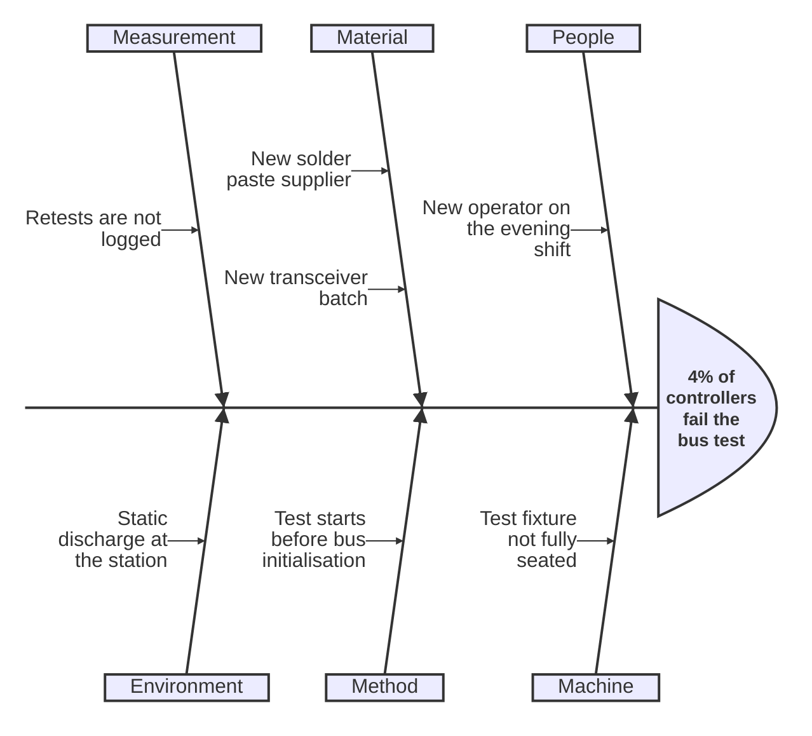

## Wardley Map

Components by their visibility to the user and by their evolution, with the dependencies between them and the expected movement.

[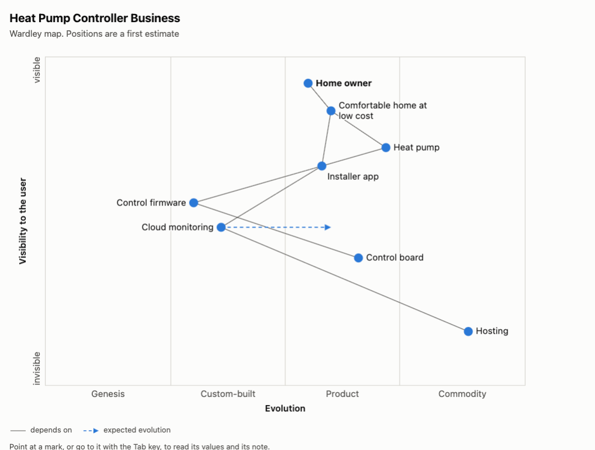](https://cybernagl.github.io/skill-thinking-tools/samples/wardley-map.html)

[Open the live page](https://cybernagl.github.io/skill-thinking-tools/samples/wardley-map.html) · [data](../viz/examples/map-wardley-heat-pump.json) · `python3 viz/show.py map data.json`

In Markdown ([source](../mermaid/wardley.mmd)). The coordinates are `[visibility, evolution]`:

```mermaid
wardley-beta
title Heat Pump Controller Business

anchor Home owner [0.95, 0.55]
component Comfortable home at low cost [0.86, 0.60]
component Heat pump [0.74, 0.72]
component Installer app [0.68, 0.58]
component Control firmware [0.56, 0.30]
component Cloud monitoring [0.48, 0.36]
component Control board [0.38, 0.66]
component Hosting [0.14, 0.90]

Home owner -> Comfortable home at low cost
Comfortable home at low cost -> Heat pump
Comfortable home at low cost -> Installer app
Heat pump -> Control firmware
Installer app -> Cloud monitoring
Control firmware -> Control board
Cloud monitoring -> Hosting

evolve Cloud monitoring 0.60
```

## Impact and Effort

Points on two axes, only for items that have scores. An estimated position has a hollow mark.

[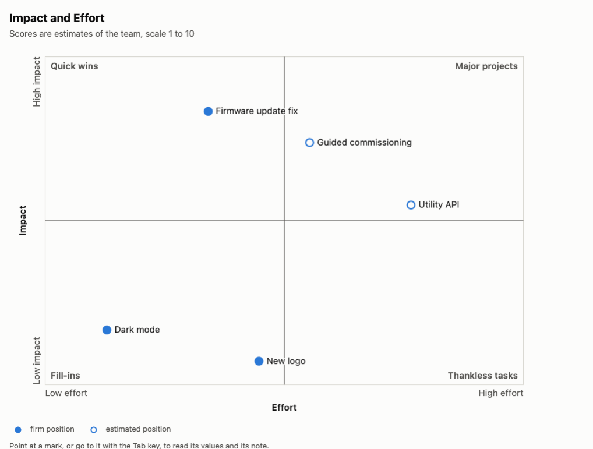](https://cybernagl.github.io/skill-thinking-tools/samples/impact-effort.html)

[Open the live page](https://cybernagl.github.io/skill-thinking-tools/samples/impact-effort.html) · [data](../viz/examples/map-impact-effort.json) · `python3 viz/show.py map data.json`

In Markdown:

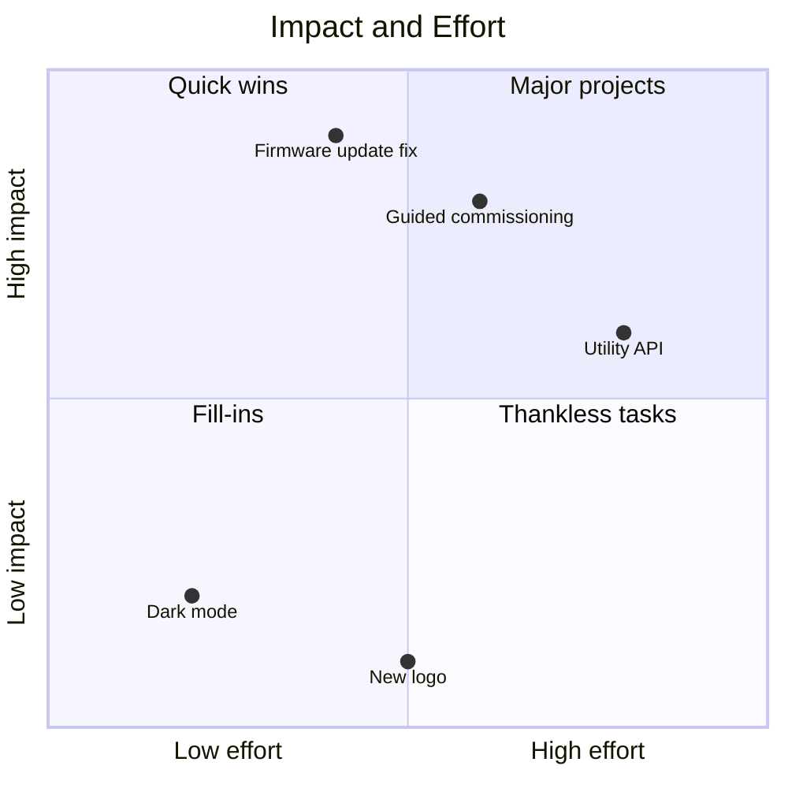

## Statement Tree

For an issue tree, a Minto pyramid, a chain of whys, second-order consequences, or an abstraction ladder. The reader collapses and expands branches.

[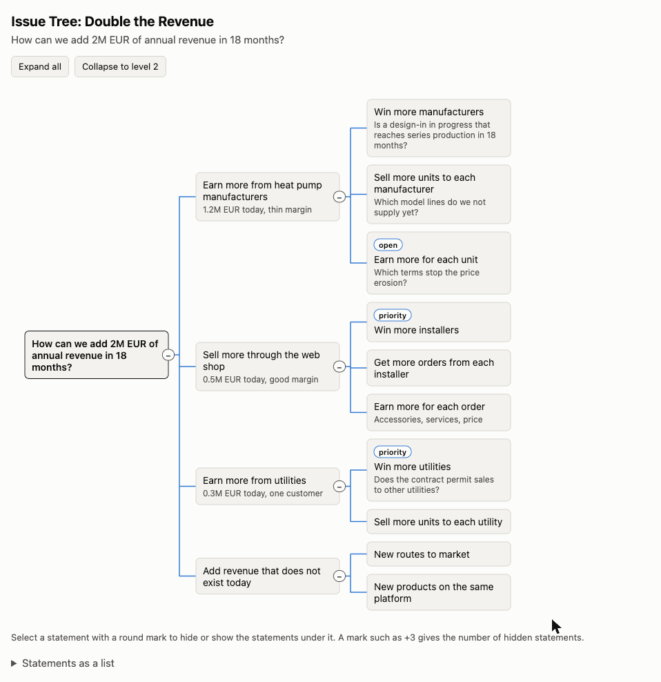](https://cybernagl.github.io/skill-thinking-tools/samples/issue-tree.html)

[Open the live page](https://cybernagl.github.io/skill-thinking-tools/samples/issue-tree.html) · [data](../viz/examples/hierarchy-issue-tree.json) · `python3 viz/show.py hierarchy data.json`

In Markdown:

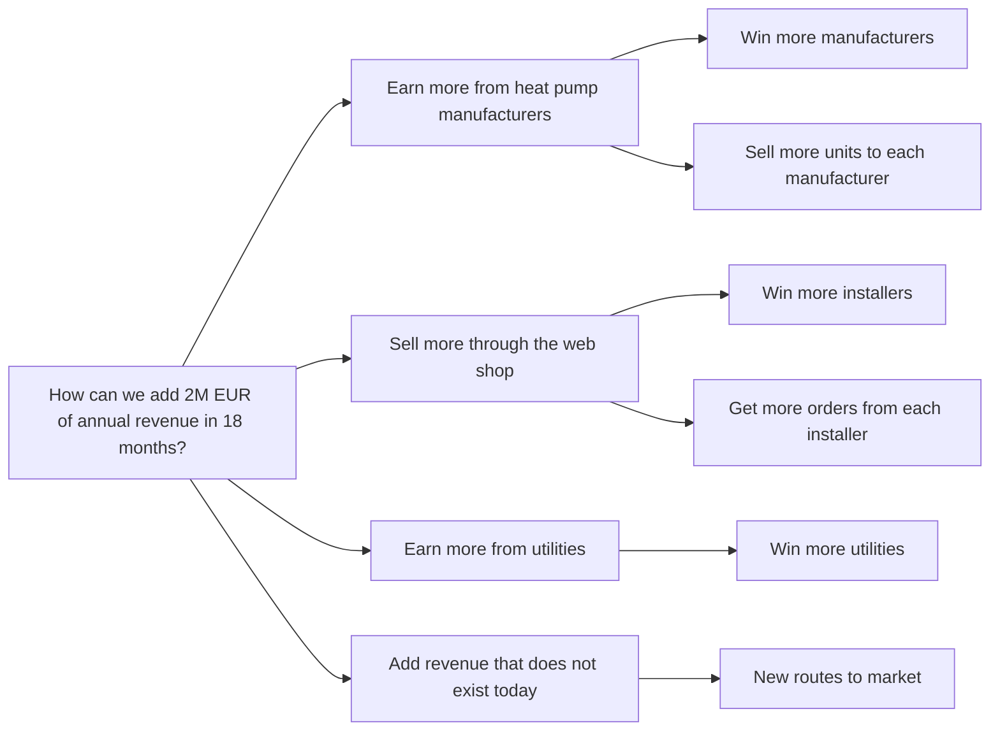

## Decision Tree

Expected values by rollback from the ends to the start. The reader moves a probability and sees if the best choice holds. The page also gives the break-even probability.

[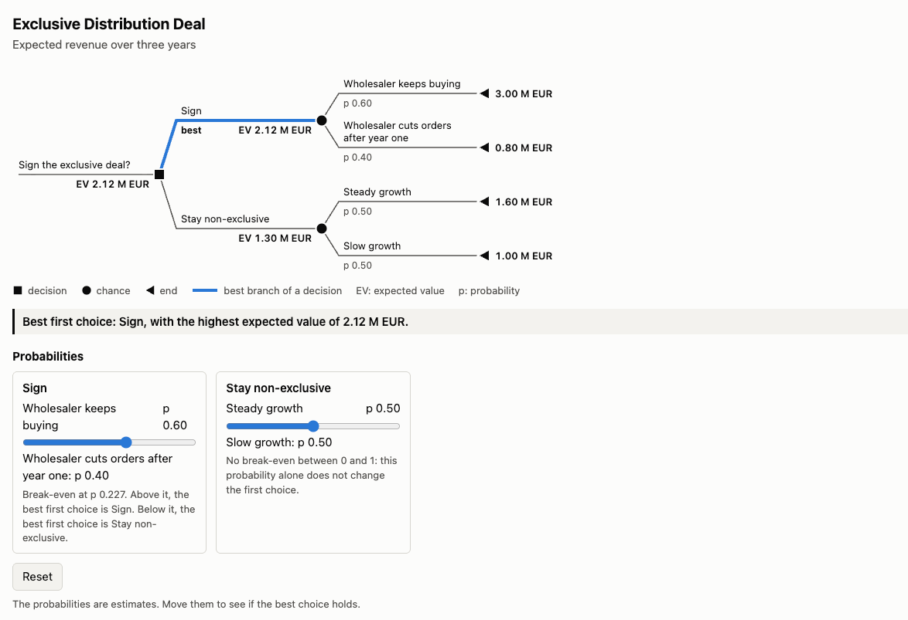](https://cybernagl.github.io/skill-thinking-tools/samples/decision-tree.html)

[Open the live page](https://cybernagl.github.io/skill-thinking-tools/samples/decision-tree.html) · [data](../viz/examples/tree-exclusive-deal.json) · `python3 viz/show.py tree data.json`

In Markdown:

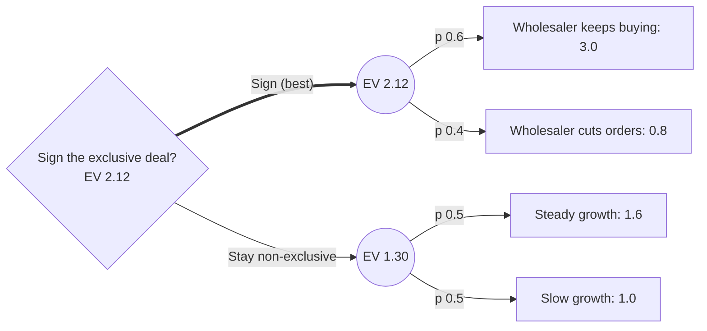

Values in M EUR. Sign: 0.6 × 3.0 + 0.4 × 0.8 = 2.12. Stay non-exclusive: 0.5 × 1.6 + 0.5 × 1.0 = 1.30.

## Decision Matrix

The reader moves the weights and sees if the ranking holds. The page states each change of first place when one weight is halved or doubled.

[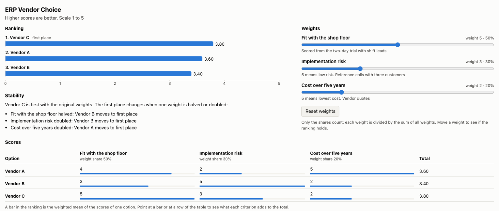](https://cybernagl.github.io/skill-thinking-tools/samples/decision-matrix.html)

[Open the live page](https://cybernagl.github.io/skill-thinking-tools/samples/decision-matrix.html) · [data](../viz/examples/matrix-erp-vendor.json) · `python3 viz/show.py matrix data.json`

In Markdown, the matrix is a table. The script gives the totals and the stability result:

| Option | Fit with the shop floor (50%) | Implementation risk (30%) | Cost over five years (20%) | Total |
|---|---|---|---|---|
| Vendor C | 5 | 3 | 2 | 3.80 |
| Vendor A | 4 | 2 | 5 | 3.60 |
| Vendor B | 3 | 5 | 2 | 3.40 |

The first place changes when the weight of the first criterion is halved (Vendor B), when the weight of the second is doubled (Vendor B), and when the weight of the third is doubled (Vendor A).

## Cynefin

Markdown only ([source](../mermaid/cynefin.mmd)). One situation has parts in different domains, so each part gets its own place.

```mermaid
cynefin-beta
  title ERP Rollout

  clear
    "Finance module"

  complicated
    "Data migration"

  complex
    "Shop-floor processes"

  chaotic
    "Line stop from a wrong stock level"

  confusion
    "What the shift leads really do"

  chaotic --> complex : "Stabilised"
  complex --> complicated : "Practice found"
```

## Conflict Resolution Diagram

Markdown only. The five boxes of the evaporating cloud; the assumptions under each arrow go into the text below the diagram.

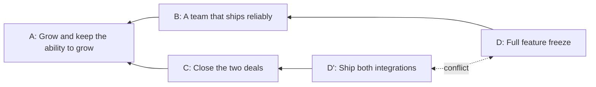

## Renderers

The fishbone, the Wardley map, and the Cynefin diagram use Mermaid diagram types that are marked as beta. They need Mermaid 11.16 or later. GitHub renders them, as this page shows, and they were checked in Obsidian 1.15.1. Each Mermaid sample on this page was checked with Mermaid 12.3.0. Each D3 page was checked in Chrome in light and dark mode.
